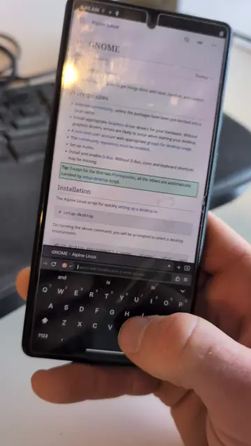

# futo-osk

A GTK 4 on-screen keyboard for phosh that types with
[FUTO Keyboard](https://github.com/futo-org/android-keyboard)'s engine:
transformer next-word prediction and autocorrect, AOSP-derived typo
correction, and swipe typing with FUTO Swipe's neural decoder, all with
FUTO's default look and layouts.

Built for postmarketOS on the Pixel 6/6a (nura / google-bluejay), but
nothing in it is device-specific.

<p align="center">
  
</p>

## How it fits together

```
phoc ── input-method-v2 / virtual-keyboard ──┐
                                              src/osk-input-wayland.c
src/osk-keyboard.c  key area: taps, swipes,   │
        │           long-press, cursor drag   │
        ▼                                     ▼
src/osk-ime.c  composing word, autocorrect + undo, swipe, automatic
        │      spaces, double-space period, auto-caps, suggestion strip
        ▼
src/osk-predictor.c  worker thread, newest request wins
        │
        ├─ swipes ─▶ src/osk-swipe-helper.c ─ pipe ─▶ futo-swipe-decoder
        │            (if installed)                   (swipe-decoder/, GPL-3.0)
        ▼
engine/futo-engine.cpp  C API, ports the Kotlin glue (merging dictionary
        │               and transformer results, context trimming)
        ▼
engine/glue-*.cpp + fake-jni.cpp
        FUTO's unmodified JNI glue and native code (ggml/llama,
        sentencepiece, AOSP suggest), driven through a stand-in JNIEnv
```

Swipes go to `futo-swipe-decoder` (FUTO Swipe's neural models) when it's
installed. It gets about 92% of words right first time on FUTO's held-out
swipe data, against 76% for the AOSP decoder, which futo-osk falls back to
otherwise. The helper is a separate program because of licensing; see
[swipe-decoder/README.md](swipe-decoder/README.md).

FUTO's source is not copied here: `scripts/fetch-futo.sh` fetches a pinned
commit, and the build compiles it in place, taking the source list from
FUTO's own `NativeFileList.cmake`.

The window is a layer-shell surface in the `osk` namespace, which phoc
treats as the on-screen keyboard. The app owns `sm.puri.OSK0` on the
session bus, so phosh's keyboard button works.

## Build and try it

```sh
scripts/fetch-futo.sh          # FUTO source, English dictionary and model (~75 MB)
meson setup build -Dfuto_resources=$PWD/futo/resources
ninja -C build
meson test -C build            # scripted typing through the whole stack, headless

# Engine alone: correct a typo, predict, decode a swipe
build/engine/futo-engine-cli futo/resources/raw/main_en.dict \
    futo/resources/raw/ml4_q6_k.gguf "I would like to" hwlp
build/engine/futo-engine-cli futo/resources/raw/main_en.dict - "" keyboard swipe

# The whole keyboard in a window with its own text field
build/src/futo-osk --test --data-dir <dir containing en/main.dict, en/model.gguf, en/words.combined>
```

`gtk4-layer-shell` is optional at build time. Without it, the keyboard runs
as a normal window.

## Alpine / postmarketOS packages

There are two recipes in `packaging/alpine/`:

- **`futo-osk`** builds:
  - **`futo-osk`:** the keyboard, plus the English dictionary, word list
    and model.
  - **`futo-osk-systemd`:** phosh's `mobi.phosh.OSK.service` unit. It
    installs itself on systemd systems.
- **`futo-swipe-decoder`** builds the neural swipe decoder and its models.
  It's optional but recommended. It builds ExecuTorch from source, which
  takes a while.

Both download their upstream sources themselves. The scripts below swap in a
tarball of your working tree for this project's own source. When you change
anything, bump `pkgrel` in the APKBUILD. Otherwise pmbootstrap reuses its
old build and apk won't reinstall the same version.

**In a container, on any Linux machine** (podman or docker):

```sh
scripts/build-alpine.sh                 # both packages, host architecture, into ./packages/
scripts/build-alpine.sh -p futo-osk     # just one
scripts/build-alpine.sh -a aarch64      # for the phone; needs qemu-user binfmt, slow
```

The APKs are signed with a throwaway key, which is saved next to them.
Install with `apk add --allow-untrusted`, or copy the `.rsa.pub` into
`/etc/apk/keys/`.

**On Alpine itself:**

```sh
sudo apk add alpine-sdk && abuild-keygen -ain   # once
scripts/stage-apkbuild.sh /tmp/futo-osk         # or: /tmp/futo-swipe-decoder futo-swipe-decoder
cd /tmp/futo-osk && abuild -r                    # APKs land in ~/packages/
```

**With pmbootstrap, for a postmarketOS device:**

```sh
scripts/stage-pmaports.sh ~/dev/pmaports        # writes temp/futo-osk/ and temp/futo-swipe-decoder/
pmbootstrap build --arch aarch64 futo-osk futo-swipe-decoder
pmbootstrap sideload futo-osk futo-osk-systemd futo-swipe-decoder
```

`gtk4-layer-shell` has to be on the device first (`apk add
gtk4-layer-shell`), because sideloading installs without network access.

**Switching to futo-osk:**

The package provides `phosh-osk-stub` and takes over stevia's
`sm.puri.OSK0.desktop` and `mobi.phosh.OSK.service`. Run `apk del stevia`,
then log out and back in, and phosh starts futo-osk.
`futo-osk --row-height N` overrides the automatic key height.

## Licence

The keyboard links FUTO's native code and ships its dictionary and model,
which are under the
[FUTO Source First License 1.1](https://github.com/futo-org/android-keyboard/blob/master/LICENSE.md).
In short: use and modification are for non-commercial purposes only, any
distribution must be free of charge and include that licence, and
modified copies must say they are modified. This is a modified derivative
of FUTO Keyboard, and is not made or endorsed by FUTO.

`engine/jni.h` is from the Android NDK (Apache-2.0). The protocol XML
files are from wlroots (MIT).

`futo-swipe-decoder` is GPL-3.0, because it's built on FUTO's swipe-library.
Its models are under the FUTO Model Weights License, which requires telling
users the keyboard is "powered by FUTO Swipe". futo-osk does this on the
space bar while the neural decoder is in use.

## Status

Tested and working on a Pixel 6a (google-bluejay) running postmarketOS
edge with phosh.

## Not done yet

- English only. Other FUTO dictionaries and models would need per-locale
  layouts.
- The neural swipe decoder isn't used for sentence context. FUTO Swipe's
  context model made no difference in testing, so it isn't packaged.
- No settings UI, emoji, clipboard, voice input or personal dictionary.
